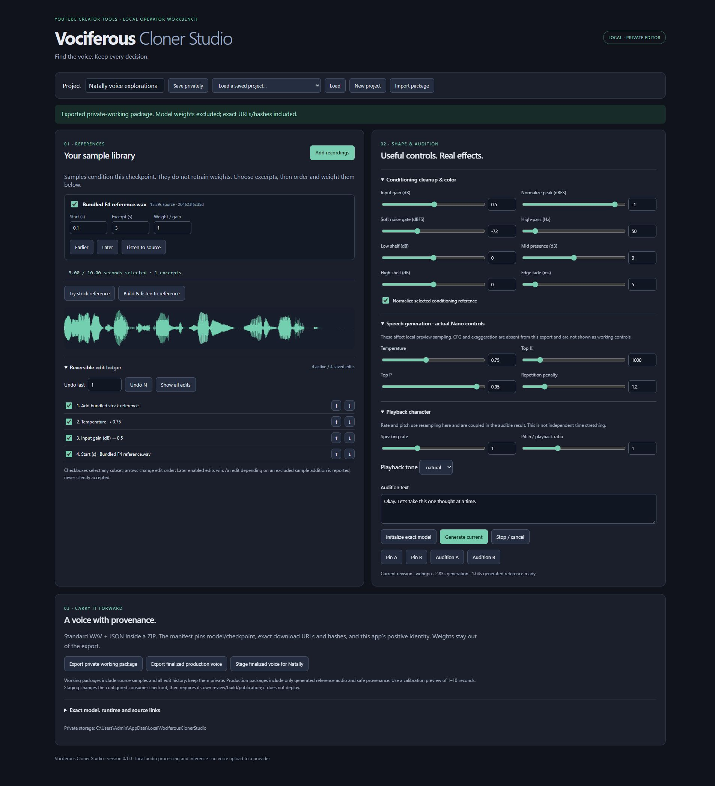

# Standalone voice workbench verification — 17 October 2026

Source: 25153eb57a5e9c20626497b16e34781be0becc57, pushed and remotely verified on codex/voice-workbench. Only the editor was established in C:/Users/Admin/Desktop/DevProjects/vociferous-cloner-studio. Natally remains E:/devProjects/natally-chatterbox. The repos have separate origins and histories.

## Observed in native Windows Chrome

- Local authenticated Web UI at 127.0.0.1:5177. Unauthenticated API read returned403; authenticated bootstrap identified the exact source commit. No token is in this report.
- Added bundled stock F4 sample and composed its selected3-second reference. Native range controls recorded gain0→0.5 and temperature0.8→0.75. Numeric excerpt start0→0.1 recorded a separate edit.
- Pinned A/B revision projections. Disabled/re-enabled an arbitrary gain edit and moved the temperature edit earlier. Saved/reloaded the4-edit project with ordering retained.
- Undo-last1 changed4active/4saved edits to3active/4saved and reverted sample start to0. Re-enabling the start edit while excluding its sample addition displayed the dependency issue. Generation with no selected sample rejected before model work.
- Three stock excerpts composed9seconds. Four stock excerpts selected12seconds and the action explicitly rejected: "Selected conditioning excerpts must total1–10seconds; none are silently discarded".
- Cancelled a pinned audition and observed "Preview stopped" persist before the next explicit Generate action. This is one cancellation observation, not an exhaustive race proof.
- Actual same-checkpoint WebGPU generation completed. Earlier cold run12.15seconds→1.24seconds PCM. Final warm run2.83seconds→1.04seconds PCM. The requested default audition phrase was "Okay. Let's take this one thought at a time." The short generated duration does NOT establish complete pronunciation, similarity, naturalness or a usable final voice. Listening/quality acceptance remains open.
- Actual UI exported private-working and production-reference ZIPs. CRC, every listed content SHA256/size, mono PCM16/24kHz and1–10second bounds passed. Both manifests identify creator mba.robin.vociferous-cloner-studio, version0.1.0, exact source25153eb, canonical GitHub URL, export UUID/time,13 pinned model-file URLs/hashes and no included weights.
- Working ZIP has conditioning WAV, source sample, project/history/pins, manifest and README. Production ZIP has ONLY generated finalized-reference.wav, manifest and README. Safe receipts are final-export-verification.json; private audio/ZIPs stay outside Git.
- Used the actual production export with the Node consumer adapter against a temporary Git checkout containing copied Natally consumer files. It staged F4.wav,F4.preset.json and the exact model-manifest cache identity, with a private rollback transaction. Previous run verified bytes/blob match. Final export update also staged successfully. The real Natally voice was not changed by this verification.

## Source/build checks

npm run check, npm run build, node --check server.mjs, node --check adapters/natally-promotion.mjs and git diff --check passed after the final source edits. No new coded browser harness or unit suite was introduced.

Independent source review found four Important defects: delayed playback after Stop, untrusted imported patch fields crossing production metadata, concurrent consumer edits/rollback clobbering, and native conditioning fault classification. Repaired in734d7f0 and focused re-review found no Critical/Important defect remaining. Subsequent small ownership/export-snapshot repairs were compiler/build/runtime checked. Consumer staging uses cooperative file identities and a lock; it is not a crash-proof filesystem transaction.

CodeGraph is initialized and current; SQLite integrity passed. The CLI reports an earlier index-engine notice. A full reindex encountered the live shared MCP writer lock, not a stale lock; the owner was preserved and queries through the MCP returned current source. No silent index bypass.

## Explicit open checks

- New local recording and working-ZIP import through the browser file chooser remain unverified: the Chrome automation extension refused file assignment until its "Allow access to file URLs" permission is enabled. Permission was left unchanged. Stock-sample ingestion exercises the private-storage path but does not prove file chooser import. The operator can use Add recordings/Import package directly in the open editor.
- No user source voice was supplied or selected. No claimed weight training. Accumulated edits condition a selected1–10second composite; they do not train checkpoint weights.
- Full A/B listening, long/short calibration phrases, source resemblance, prosody and audible completeness remain operator quality checks. Do not promote the stock test reference as Natally's finalized voice.
- The enabled consumer action is staging only. A chosen voice still requires review/build/publication and actual production listening. No public editing or cloning endpoint is deployed.
